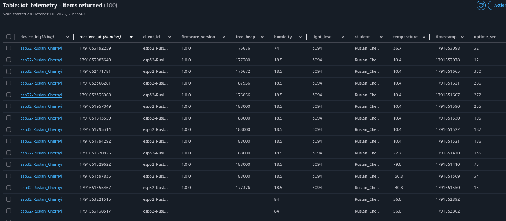
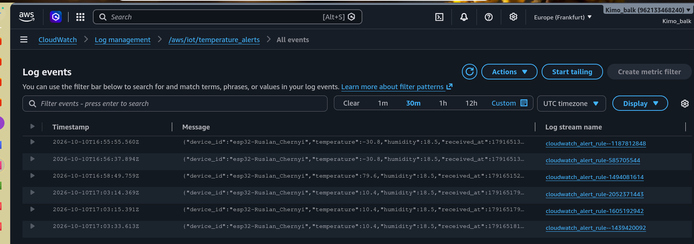
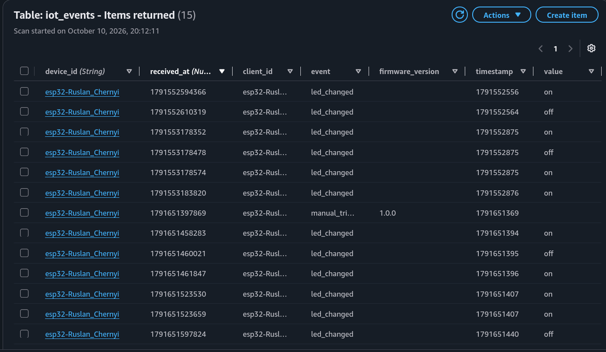
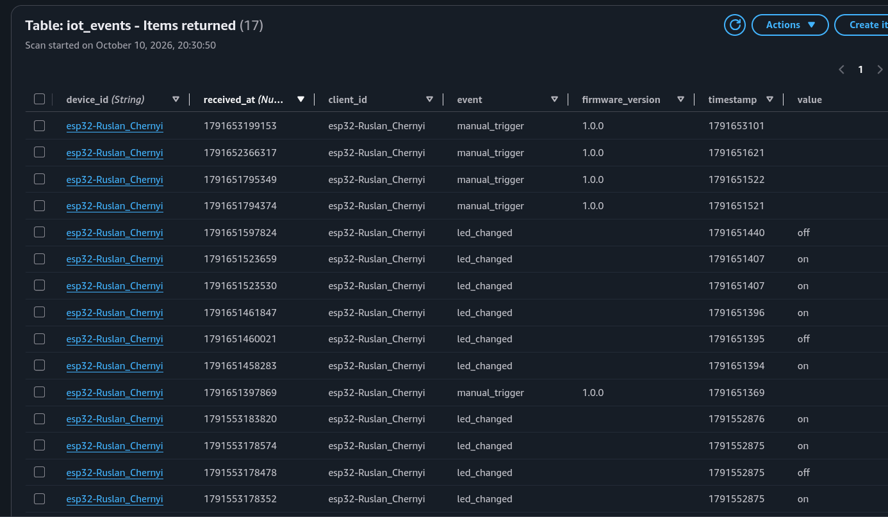
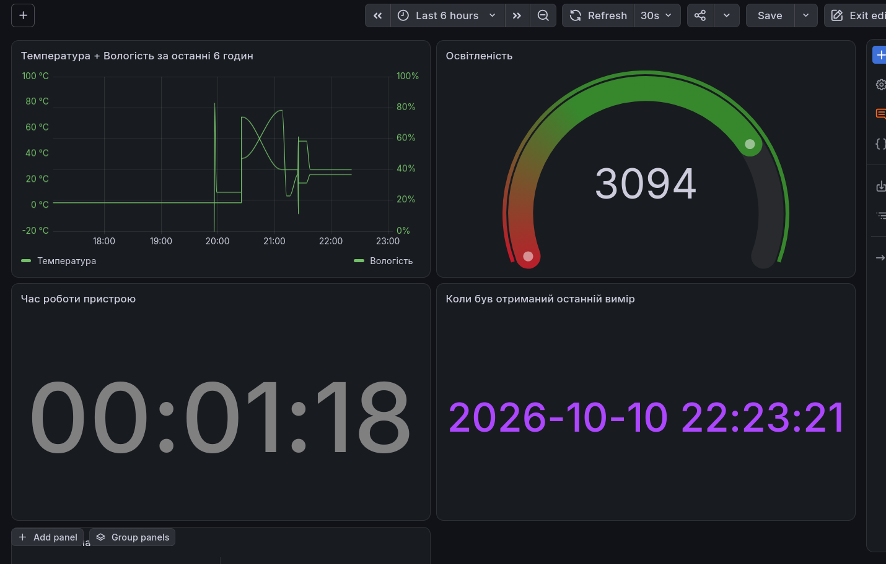
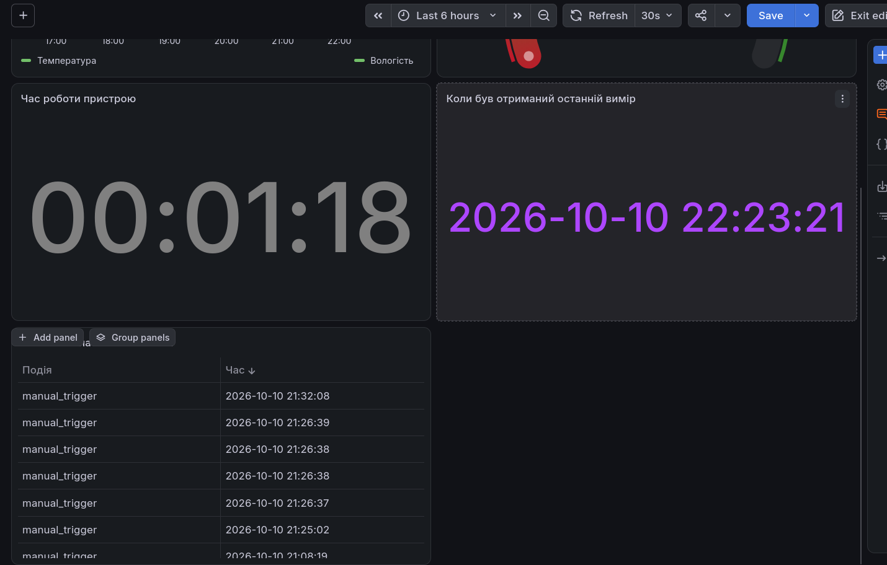
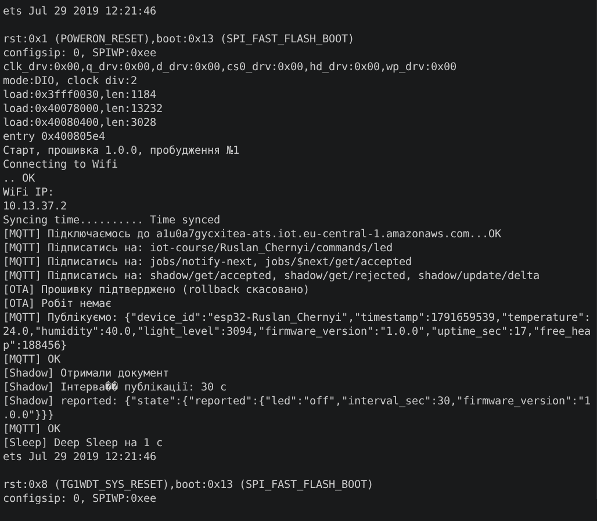
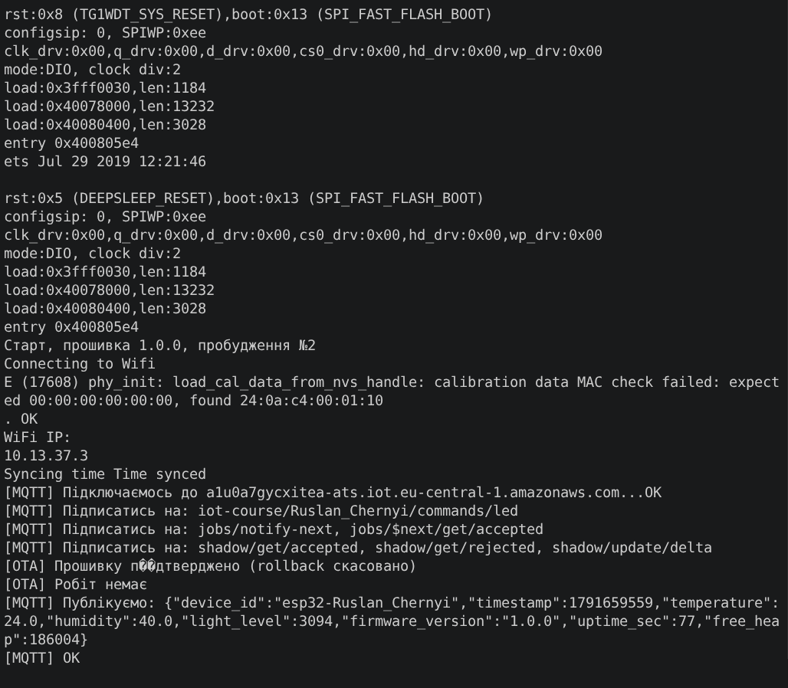
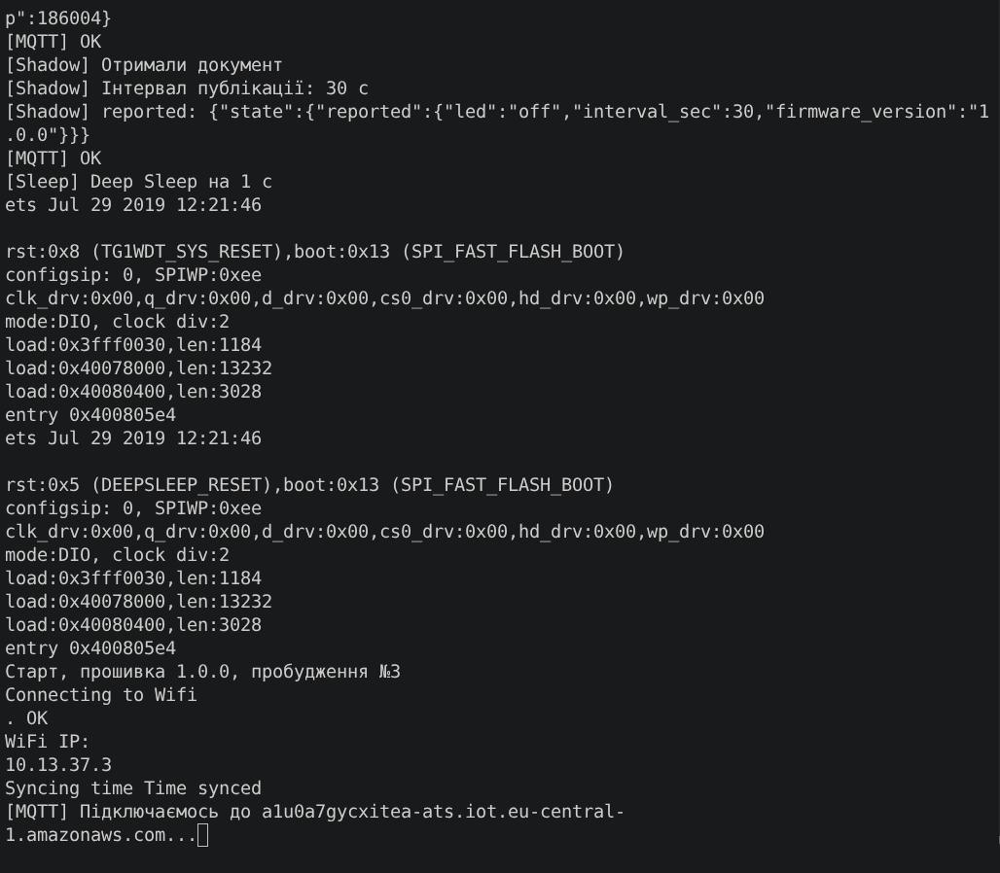

# Курсовий проєкт: моніторинг мікроклімату на ESP32 + AWS IoT

ESP32 + AWS IoT Core + DynamoDB + FastAPI + Grafana. ESP32 (Wokwi: DHT22, фоторезистор, кнопка, LED) шле телеметрію
через MQTT/TLS в AWS IoT Core, Rules Engine складає її в DynamoDB і пише алерти температури в CloudWatch, FastAPI
віддає дані в Grafana. У зворотний бік: HTML-сторінка → FastAPI → AWS IoT → ESP32 вмикає/вимикає світлодіод
і підтверджує це подією. Конфігурація пристрою (LED, інтервал) — через Device Shadow, оновлення прошивки — OTA
через AWS IoT Jobs і S3. Окрема збірка — режим Deep Sleep.

## Демонстрація

Відео роботи системи: зміна даних у Wokwi → оновлення графіка в Grafana → кнопка в Grafana → світлодіод у Wokwi —
[Project demonstration.mp4](docs/screenshots/Project%20demonstration.mp4).

Оновлення прошивки 1.0.0 → 1.1.0 через AWS IoT Jobs — [OTA from 1_0_0 to 1_1_0.mp4](docs/screenshots/OTA%20from%201_0_0%20to%201_1_0.mp4)
(див. розділ 8).

## Архітектура

```text
                 ┌─────────────────────────────────────────────────────┐
                 │  ESP32 (Wokwi), прошивка 1.0.0 → 1.1.0              │
                 │  DHT22 → D4, фоторезистор → D34,                    │
                 │  кнопка → D27, LED → D2 (через 220 Ω)               │
                 └───────┬────────────────────▲───────────────────▲────┘
  ① .../telemetry 60 с   │  MQTT/TLS :8883    │ ④ commands/led    │ ⑧ HTTPS GET
  ⑤ .../events           │  (X.509, mTLS)     │ ⑥ shadow/delta    │   firmware_1_1_0.bin
  ⑥ shadow/update        │                    │ ⑦ jobs/notify     │   (presigned URL)
    (reported)           │                    │                   │
                         ▼                    │                   │
┌─────────────────────────────────────────────┴───────┐   ┌───────┴────────────────┐
│  AWS IoT Core (eu-central-1)                        │   │  S3 (приватний бакет)  │
│                                                     │   │  firmware_1_1_0.bin    │
│  Rules Engine:                                      │   │  job-ota-1.1.0.json    │
│    StoreTelemetry ── dynamoDBv2 ─► iot_telemetry    │   └───────▲────────────────┘
│    StoreEvents ───── dynamoDBv2 ─► iot_events       │           │ presign URL
│    cloudwatch_alert_rule (temp > 28 або < 15)       │           │ (iot_ota_presign_role)
│      └─► CloudWatch /aws/iot/temperature_alerts     ├───────────┘
│    error action ─► CloudWatch /aws/iot/rules/errors │
│  Device Shadow: desired / reported / delta          │
│  Jobs: ota-1-1-0 (1.0.0 → 1.1.0)                    │
└─────────┬──────────────────────────────────▲────────┘
          │                                  │ ③ iot-data Publish (commands/led),
          ▼                                  │   Get/UpdateThingShadow (HTTPS)
┌──────────────────┐    ② Query         ┌────┴──────────────────────┐
│  DynamoDB        │ ──────────────────►│  FastAPI :8000            │
│  iot_telemetry   │                    │  GET  /health             │
│  iot_events      │                    │  GET  /sensors/latest     │
└──────────────────┘                    │  GET  /sensors/history    │
                                        │  GET  /events             │
                                        │  POST /actuators/led      │
                                        │  GET  /shadow             │
                                        │  PUT  /shadow/desired     │
                                        └──▲─────────────────▲──────┘
                                GET (JSON) │                 │ POST (fetch)
                    ┌──────────────────────┴──┐    ┌─────────┴───────────┐
                    │ Grafana :3000           │    │ web/index.html      │
                    │ Infinity datasource     │    │ кнопки Увімк/Вимк   │
                    └─────────────────────────┘    └─────────────────────┘
```

- **Дані вгору (①②):** ESP32 → `telemetry` → правило `StoreTelemetry` → DynamoDB → FastAPI → Grafana.
- **Команди вниз (③④):** кнопка на сторінці → `POST /actuators/led` → `iot-data:Publish` → `commands/led` → ESP32 перемикає LED.
- **Події (⑤):** `led_changed` (після `digitalWrite`) і `manual_trigger` (кнопка D27) → `events` → правило `StoreEvents` →
  таблиця `iot_events` → `GET /events` → панель Table у Grafana.
- **Shadow (⑥):** `PUT /shadow/desired` або консоль → `desired` → пристрій отримує `delta`, виконує і звітує `reported`
  (`led`, `interval_sec`, `firmware_version`).
- **OTA (⑦⑧):** job `ota-1-1-0` → `jobs/notify-next` → пристрій бере документ роботи, де AWS IoT підставив presigned URL
  (роль `iot_ota_presign_role`) → завантажує `firmware_1_1_0.bin` з приватного S3 по HTTPS → перезавантаження.
- **Алерти:** правило `cloudwatch_alert_rule` пише в CloudWatch кожен вимір із `temperature > 28` або `< 15`.

## Структура репозиторію

```text
firmware/                    PlatformIO-проєкт ESP32
  platformio.ini             збірка, запінена платформа espressif32@6.13.0 і бібліотеки
  include/config.h           версія, Wi-Fi, топіки, інтервали, піни
  src/main.cpp               setup() і loop()
  src/network.*              Wi-Fi, TLS, NTP, MQTT-підключення, колбек-диспетчер
  src/sensors.*              DHT22 і фоторезистор
  src/telemetry.*            публікація телеметрії та подій
  src/led.*, src/button.*    світлодіод (команди) і кнопка з debounce
  src/shadow.*               Device Shadow
  src/ota.*                  OTA через AWS IoT Jobs
  src/power.*                RTC-пам'ять і Deep Sleep
  include/example.secrets.h  шаблон сертифікатів → скопіювати в include/secrets.h
  partitions.csv             таблиця розділів з двома OTA-слотами
  merge_bin.py               після збірки складає merged.bin для Wokwi
  diagram.json, wokwi.toml   схема і конфіг Wokwi
backend/                     FastAPI
  main.py                    ендпоінти, CORS
  db.py                      запити до DynamoDB
  iot.py                     публікація команд і Device Shadow (AWS IoT data plane)
  requirements.txt           залежності Python
  .env.example               шаблон змінних середовища (без реальних значень)
aws/                         документи AWS
  thing-policy.json          політика Thing
  backend-iam-policy.json    inline policy IAM-користувача бекенду
  rules/*.json               три IoT Rules (StoreTelemetry, StoreEvents, cloudwatch_alert_rule)
  job-ota-1.1.0.json         документ OTA-роботи (AWS IoT Jobs)
  iam/ota-presign-role-*.json  роль, якою AWS IoT підписує посилання на прошивку в S3
grafana/dashboard.json       експорт дашборду (JSON Model)
web/index.html               сторінка з кнопками керування LED
docs/screenshots/            скріншоти і відео для здачі
```

## Параметри

| Що | Значення |
|---|---|
| Регіон | `eu-central-1` (усі ресурси в одному регіоні) |
| Thing / Client ID / `device_id` | `esp32-Ruslan_Chernyi` |
| Телеметрія (пристрій → хмара) | `iot-course/Ruslan_Chernyi/telemetry` — `{"device_id","timestamp","temperature","humidity","light_level","firmware_version","uptime_sec","free_heap"}` |
| Команди (хмара → пристрій) | `iot-course/Ruslan_Chernyi/commands/led` — `{"action":"set_led","value":"on"\|"off"}` |
| Події (пристрій → хмара) | `iot-course/Ruslan_Chernyi/events` — `{"event":"led_changed","value":"on"}`, `{"event":"manual_trigger"}` або `{"error":"dht_read_failed"}` |
| Таблиці DynamoDB | `iot_telemetry` і `iot_events` (обидві: `device_id` String + `received_at` Number, мс) |
| OTA (AWS IoT Jobs) | `$aws/things/esp32-Ruslan_Chernyi/jobs/...` — `notify-next`, `$next/get`, `$next/get/accepted`, `<jobId>/update` |

## Створені ресурси AWS

| Тип | Назва | Призначення |
|---|---|---|
| IoT Thing | `esp32-Ruslan_Chernyi` | пристрій, до нього прикріплений сертифікат |
| IoT Certificate | (auto-generated) | mTLS-автентифікація ESP32 |
| IoT Policy | політика пристрою (JSON нижче) | Connect лише своїм Client ID, Publish/Subscribe/Receive лише в `iot-course/Ruslan_Chernyi/*` |
| IoT Rule | `StoreTelemetry` | телеметрія → DynamoDB, error action → CloudWatch |
| IoT Rule | `cloudwatch_alert_rule` | `temperature > 28 OR temperature < 15` → CloudWatch, error action → CloudWatch |
| IoT Rule | `StoreEvents` | події → DynamoDB `iot_events`, error action → CloudWatch |
| DynamoDB table | `iot_telemetry` | телеметрія, On-demand |
| DynamoDB table | `iot_events` | події пристрою (`led_changed`, `dht_read_failed`), On-demand |
| IAM role | `iot_rule_ddb_role` | дозволяє `StoreTelemetry` робити `dynamodb:PutItem` в `iot_telemetry` |
| IAM role | `iot_rule_events_ddb_role` | дозволяє `StoreEvents` робити `dynamodb:PutItem` в `iot_events` |
| IAM role | `iot_rule_cw_role` | дозволяє правилам писати в CloudWatch Logs |
| CloudWatch log groups | `/aws/iot/rules/errors`, `/aws/iot/temperature_alerts` | помилки правил і алерти температури |
| IAM user | `iot-course-backend` | під ним працює FastAPI (ключі в `backend/.env`) |
| S3 bucket | `<BUCKET>` (приватний) | `firmware_1_1_0.bin` і `job-ota-1.1.0.json` |
| IAM role | `iot_ota_presign_role` | дозволяє AWS IoT робити `s3:GetObject` у бакеті — для presigned URL |
| IoT Job | `ota-1-1-0` | оновлення 1.0.0 → 1.1.0 для `esp32-Ruslan_Chernyi` |

## Налаштування з нуля

### 1. AWS IoT: Thing, сертифікат, Policy

1. Перевірити регіон **eu-central-1** у правому верхньому куті консолі.
2. **AWS IoT Core → Manage → Things → Create thing** → `esp32-Ruslan_Chernyi`.
3. **Auto-generate certificate** → завантажити `certificate.pem.crt`, `private.pem.key`, `AmazonRootCA1.pem`.
4. Створити і прикріпити до сертифіката Policy (тільки власний Client ID, власні топіки і власна гілка Jobs) —
   [aws/thing-policy.json](aws/thing-policy.json), замінивши `<ACCOUNT_ID>`:

```json
{
  "Version": "2012-10-17",
  "Statement": [
    { "Effect": "Allow", "Action": "iot:Connect",
      "Resource": "arn:aws:iot:eu-central-1:<ACCOUNT_ID>:client/esp32-Ruslan_Chernyi" },
    { "Effect": "Allow", "Action": "iot:Publish",
      "Resource": [
        "arn:aws:iot:eu-central-1:<ACCOUNT_ID>:topic/iot-course/Ruslan_Chernyi/*",
        "arn:aws:iot:eu-central-1:<ACCOUNT_ID>:topic/$aws/things/esp32-Ruslan_Chernyi/jobs/*",
        "arn:aws:iot:eu-central-1:<ACCOUNT_ID>:topic/$aws/things/esp32-Ruslan_Chernyi/shadow/*"
      ] },
    { "Effect": "Allow", "Action": "iot:Subscribe",
      "Resource": [
        "arn:aws:iot:eu-central-1:<ACCOUNT_ID>:topicfilter/iot-course/Ruslan_Chernyi/*",
        "arn:aws:iot:eu-central-1:<ACCOUNT_ID>:topicfilter/$aws/things/esp32-Ruslan_Chernyi/jobs/*",
        "arn:aws:iot:eu-central-1:<ACCOUNT_ID>:topicfilter/$aws/things/esp32-Ruslan_Chernyi/shadow/*"
      ] },
    { "Effect": "Allow", "Action": "iot:Receive",
      "Resource": [
        "arn:aws:iot:eu-central-1:<ACCOUNT_ID>:topic/iot-course/Ruslan_Chernyi/*",
        "arn:aws:iot:eu-central-1:<ACCOUNT_ID>:topic/$aws/things/esp32-Ruslan_Chernyi/jobs/*",
        "arn:aws:iot:eu-central-1:<ACCOUNT_ID>:topic/$aws/things/esp32-Ruslan_Chernyi/shadow/*"
      ] }
  ]
}
```

`Subscribe` + `Receive` покривають і `commands/led`, тож для команд окремих змін у політиці не треба.
Усі топіки Jobs — одна гілка `jobs/`, усі топіки Shadow — гілка `shadow/`, тому для кожної додано по одному ресурсу
в Publish, Subscribe і Receive. Без `shadow/*` AWS розриває з'єднання на першому ж `shadow/get` (`state=-3`), і пристрій
нескінченно перепідключається.
`*` у політиці — вайлдкард IAM, а не MQTT-шний `#`.

5. Device data endpoint: **IoT Core → Settings** (вигляд `xxxx-ats.iot.eu-central-1.amazonaws.com`).
   Він потрібен і прошивці (`DOMAIN_ADDRESS` у `firmware/include/config.h`), і бекенду (`IOT_ENDPOINT` у `.env`).

### 2. DynamoDB і правила

Таблиця `iot_telemetry`: partition key `device_id` (**String**), sort key `received_at` (**Number**), Default settings (On-demand).

Правило `StoreTelemetry`, SQL version `2016-03-23`:

```sql
SELECT *,
       timestamp() AS received_at,
       clientid()  AS client_id,
       topic(2)    AS student
FROM 'iot-course/Ruslan_Chernyi/telemetry'
```

- Дія: **DynamoDBv2** → `iot_telemetry`, роль `iot_rule_ddb_role` (Create new role)
- Error action: **CloudWatch Logs** → `/aws/iot/rules/errors`, роль `iot_rule_cw_role`



Правило `cloudwatch_alert_rule`:

```sql
SELECT device_id, temperature, humidity, timestamp() AS received_at
FROM 'iot-course/Ruslan_Chernyi/telemetry'
WHERE temperature > 28 OR temperature < 15
```

- Дія: **CloudWatch Logs** → `/aws/iot/temperature_alerts`
- Error action: **CloudWatch Logs** → `/aws/iot/rules/errors`

Алерти в `/aws/iot/temperature_alerts` — і перегрів (79.6 °C), і холод (−30.8 °C, 10.4 °C):



#### Події: таблиця `iot_events` і правило `StoreEvents`

Таблиця `iot_events`: ті самі ключі — `device_id` (**String**) + `received_at` (**Number**), On-demand.

Правило `StoreEvents`:

```sql
SELECT *,
       timestamp() AS received_at,
       clientid()  AS client_id
FROM 'iot-course/Ruslan_Chernyi/events'
```

- Дія: **DynamoDBv2** → `iot_events`, роль **Create new role** → `iot_rule_events_ddb_role`
  (роль `iot_rule_ddb_role` дозволяє `PutItem` лише в `iot_telemetry`, тож для нової таблиці — нова роль)
- Error action: **CloudWatch Logs** → `/aws/iot/rules/errors`, роль `iot_rule_cw_role`

У таблицю потрапляють усі події: `{"event":"led_changed","value":"on"}`, `{"event":"manual_trigger"}` і `{"error":"dht_read_failed"}`.





#### Error action: як перевірити, що він працює

Error action спрацьовує, коли правило **спрацювало, але дія впала** (не коли повідомлення не підійшло під `WHERE`).
Без нього такі повідомлення зникають мовчки: ESP32 бачить `publish OK`, у таблиці — порожньо, помилок — ніде.

1. У `StoreEvents` тимчасово прибрати рядок `timestamp() AS received_at,` → **Update**.
2. Натиснути кнопку на HTML-сторінці. У MQTT test client подія є, у `iot_events` нового запису немає.
3. **CloudWatch → Log groups → `/aws/iot/rules/errors`** → повідомлення з `ruleName`, `failures[].errorMessage`
   (немає sort key `received_at`) і `base64OriginalPayload` — втрачений payload.
4. Повернути рядок назад → **Update**.

### 3. IAM-користувач для бекенду

**IAM → Users → Create user** → `iot-course-backend` → **Security credentials → Create access key**
(ключі підуть у `backend/.env`). Inline policy — лише читання своїх таблиць, публікація лише у свої команди і Shadow лише свого Thing:

```json
{
  "Version": "2012-10-17",
  "Statement": [
    { "Effect": "Allow", "Action": "dynamodb:Query",
      "Resource": [
        "arn:aws:dynamodb:eu-central-1:<ACCOUNT_ID>:table/iot_telemetry",
        "arn:aws:dynamodb:eu-central-1:<ACCOUNT_ID>:table/iot_events"
      ] },
    { "Effect": "Allow", "Action": "iot:Publish",
      "Resource": "arn:aws:iot:eu-central-1:<ACCOUNT_ID>:topic/iot-course/Ruslan_Chernyi/commands/*" },
    { "Effect": "Allow", "Action": ["iot:GetThingShadow", "iot:UpdateThingShadow"],
      "Resource": "arn:aws:iot:eu-central-1:<ACCOUNT_ID>:thing/esp32-Ruslan_Chernyi" }
  ]
}
```

Без `iot:Publish` ендпоінт `POST /actuators/led` поверне `502 ForbiddenException`,
без `iot:GetThingShadow` / `iot:UpdateThingShadow` — те саме для `/shadow`.

### 4. Прошивка ESP32

```bash
cd firmware
cp include/example.secrets.h include/secrets.h   # вставити вміст трьох .pem файлів
pio run                                          # збірка → firmware.bin і merged.bin
```

Wokwi запускає `.pio/build/esp32dev/merged.bin` (bootloader + таблиця розділів + прошивка), а не `firmware.bin`:
інакше в симуляторі немає таблиці розділів на `0x8000`, і `Update.begin()` не знаходить OTA-слот.
`merged.bin` складає `merge_bin.py` автоматично після кожного `pio run`.

Симуляція: VS Code + розширення **Wokwi** → `F1 → Wokwi: Select Config File` → `firmware/wokwi.toml`, потім `F1 → Wokwi: Start Simulator`. Serial Monitor — `115200`.

Бібліотеки (ставляться автоматично з `platformio.ini`): `adafruit/DHT sensor library`,
`knolleary/PubSubClient`, `bblanchon/ArduinoJson` — версії запінені.

Що робить прошивка:

- при старті блимає LED `BOOT_BLINKS` разів (видима різниця між версіями прошивки);
- раз на 60 с (або `interval_sec` із Shadow; і одразу після підключення) читає DHT22 і фоторезистор (D34) і публікує в `telemetry`
  `temperature`, `humidity`, `light_level` (0 = темно, 4095 = світло), `firmware_version`, `uptime_sec`, `free_heap`;
- кнопка D27 (debounce 30 мс; RTC-пін, тож у режимі Deep Sleep вона ще й будить пристрій) — позачергова телеметрія і подія `{"event":"manual_trigger"}` у `events`;
- підписана на `commands/led` (QoS 1): парсить JSON, на `{"action":"set_led","value":"on"|"off"}` вмикає/вимикає LED на D2
  і **після** цього публікує `{"device_id","timestamp","event":"led_changed","value"}` у `events`;
  невалідний JSON або невідомі `action`/`value` ігноруються з повідомленням у Serial;
- слухає AWS IoT Jobs і оновлює себе по OTA — див. розділ 8.

| Збій | Поведінка |
|---|---|
| Wi-Fi не підключився | не блокує старт; `loop()` викликає `WiFi.reconnect()` з паузами 1 → 2 → 4 → 8 → 16 → 30 с |
| NTP не пройшов за 10 с | старт продовжується, `timestamp` = `0`; SNTP досинхронізується у фоні |
| MQTT відвалився | reconnect без `delay()` з паузами 1 → 2 → 4 → 8 → 16 → 30 с (максимум), після успіху пауза знову 1 с; після reconnect — повторні підписки |
| DHT22 повернув NaN | телеметрія не публікується, натомість `{"error":"dht_read_failed"}` у `events` |

### 5. Бекенд (FastAPI)

Потрібен Python 3.10+.

```bash
python -m venv .venv
source .venv/bin/activate          # Windows: .venv\Scripts\activate
pip install -r backend/requirements.txt
```

`backend/.env` (шаблон — `backend/.env.example`):

```ini
AWS_ACCESS_KEY_ID=...                 # ключі IAM-користувача iot-course-backend
AWS_SECRET_ACCESS_KEY=...
AWS_DEFAULT_REGION=eu-central-1
TABLE_NAME=iot_telemetry
EVENTS_TABLE_NAME=iot_events
DEVICE_ID=esp32-Ruslan_Chernyi
IOT_ENDPOINT=xxxx-ats.iot.eu-central-1.amazonaws.com
COMMAND_TOPIC=iot-course/Ruslan_Chernyi/commands/led
```

Запуск:

```bash
cd backend
uvicorn main:app --reload           # http://127.0.0.1:8000, Swagger — /docs
```

| Ендпоінт | Що робить |
|---|---|
| `GET /health` | `{"status":"ok"}` |
| `GET /sensors/latest` | останній запис пристрою з DynamoDB (404, якщо даних немає) |
| `GET /sensors/history?hours=6` | записи за останні N годин, найстаріші згори (`hours` 1–24, за замовчуванням 6) |
| `GET /events?limit=10&event=manual_trigger` | останні N подій з `iot_events`, найновіші згори (`limit` 1–100, за замовчуванням 10); `event` — лише події цього типу |
| `POST /actuators/led` | тіло `{"action":"set_led","value":"on"\|"off"}` → публікація в `commands/led` і той самий стан у Shadow `desired.led`; інші значення → 422 |
| `GET /shadow` | `desired`, `reported`, `delta` і `version` документа Shadow (404, якщо Shadow ще не створений) |
| `PUT /shadow/desired` | тіло `{"led":"on"\|"off","interval_sec":10–3600}` (хоча б одне поле) → `desired`; пристрій отримає `delta` |

Перевірка через curl:

```bash
curl localhost:8000/sensors/latest
curl "localhost:8000/sensors/history?hours=6"
curl "localhost:8000/events?limit=10&event=manual_trigger"
curl -X POST localhost:8000/actuators/led \
     -H 'Content-Type: application/json' -d '{"action":"set_led","value":"on"}'
curl localhost:8000/shadow
curl -X PUT localhost:8000/shadow/desired \
     -H 'Content-Type: application/json' -d '{"led":"on","interval_sec":30}'
```

`/events` з фільтром гортає сторінки DynamoDB сам: `Limit` у DynamoDB рахує записи **до** фільтра,
тож `Limit=10` + `event=manual_trigger` могло б повернути порожній список, хоча натискання є.

`200 {"status":"sent"}` означає, що брокер прийняв команду. Що LED справді змінився —
підтверджує подія `led_changed` у топіку `events` (видно в **IoT Core → MQTT test client**).

CORS увімкнено (`allow_origins=["*"]`) — інакше браузер заблокує запити з HTML-сторінки.

#### Device Shadow: перевірка

Shadow зберігає бажаний стан пристрою в хмарі: `desired` — що хоче користувач, `reported` — що пристрій реально робить,
`delta` — різниця між ними. Змінити `desired` можна через `PUT /shadow/desired` або в консолі
(**IoT Core → Things → esp32-Ruslan_Chernyi → Device Shadows → Classic Shadow → Edit**).
Пристрій отримує `delta`, виконує її і звітує новий `reported`.

`desired.interval_sec = 30` — пристрій застосовує новий інтервал публікації:


`desired.led` змінено з `off` на `on` — LED у Wokwi засвітився, у `events` пішла подія `led_changed`:


Після цього `desired.led` повернуто в `off` — пристрій отримав `delta`, вимкнув LED і звітував `reported.led = "off"`:


Shadow має пріоритет над `commands/led`: якщо ввімкнути LED командою, а в `desired` лишилось `off`,
пристрій отримає `delta` і поверне LED до `desired`. Тому `POST /actuators/led` оновлює й `desired.led`.

### 6. HTML-сторінка керування

`web/index.html` — дві кнопки, що шлють `POST /actuators/led`. Адреса API задана в `API_URL` (`http://127.0.0.1:8000`).

```bash
cd web
python -m http.server 5500          # http://localhost:5500
```

Або просто відкрити файл у браузері. Окрема сторінка потрібна, бо в Grafana OSS немає кнопки з POST без додаткових плагінів.

### 7. Grafana

Grafana запущена локально на `http://localhost:3000` (дашборд експортовано з Grafana 13).

1. **Administration → Plugins** → встановити **Infinity** (`yesoreyeram-infinity-datasource`).
2. **Connections → Data sources → Add → Infinity** → Save (додаткових налаштувань не треба — URL задані в панелях).
3. **Dashboards → New → Import** → завантажити `grafana/dashboard.json`.
   Якщо панелі показують «datasource not found» — у кожній панелі **Edit** → обрати свій Infinity datasource.

Панелі (усі — Infinity, Type `JSON`, Parser `Backend`, Method `GET`):

| Панель | Тип | URL | Колонки |
|---|---|---|---|
| Температура + Вологість за останні 6 годин | Time series | `/sensors/history?hours=6` | `timestamp` (epoch, **s**), `temperature` (°C, ліва вісь), `humidity` (%, права вісь) |
| Освітленість | Gauge | `/sensors/latest` | `light_level` (0–4095; червона зона — темно, зелена — норма) |
| Час роботи пристрою | Stat | `/sensors/latest` | `uptime_sec` (duration) |
| Коли був отриманий останній вимір | Stat | `/sensors/latest` | `received_at` (epoch, **ms**) — час AWS |
| Останні 10 натискань кнопки | Table | `/events?limit=10&event=manual_trigger` | `received_at` (epoch, **ms**), `event` |
| Керування LED | Canvas | `POST /actuators/led` | дві кнопки (Button, Experimental element types), payload `{"action":"set_led","value":"on"\|"off"}`; Inline editing вимкнено |

`timestamp` ставить пристрій у секундах, `received_at` — правило в мілісекундах. Якщо переплутати тип колонки,
дата виявиться в 1970-му або в далекому майбутньому.

Дашборд: діапазон часу `Last 6 hours`, автооновлення `30s`.





### 8. OTA через AWS IoT Jobs (1.0.0 → 1.1.0)

#### Як це влаштовано

Флеш поділено на два однакові слоти `app0`/`app1` по 1.5 МБ ([firmware/partitions.csv](firmware/partitions.csv)).
Нова прошивка пишеться у **вільний** слот, поки стара працює; перемикання (`otadata`) — лише після перевірки образу.
Обірвався зв'язок посеред завантаження — зіпсований тільки вільний слот, пристрій живе далі на старій версії.

```text
 Ви: Create job ──► AWS IoT Jobs ── notify-next ──► ESP32 (1.0.0)
                         ▲                            │ $next/get
                         │                            ▼
                         │   документ роботи з presigned URL (живе ≤ 3600 с)
                         │                            │
                         ├──────── IN_PROGRESS ◄──────┤
                         │                            │ MQTT відключено
                         │      S3 (приватний) ──HTTPS──► Update: запис у вільний слот → otadata → рестарт
                         │                            │
                         │                            ▼
                         │                       ESP32 (1.1.0): MQTT OK → esp_ota_mark_app_valid_cancel_rollback()
                         │                            │ $next/get → та сама робота, версія збігається
                         └──────── SUCCEEDED ◄────────┘
```

Що робить прошивка ([firmware/src/ota.cpp](firmware/src/ota.cpp)):

| Момент | Дія |
|---|---|
| кожне підключення до MQTT | підписка на `jobs/notify-next` і `jobs/$next/get/accepted`, потім публікація в `jobs/$next/get` — роботу могли створити, поки пристрій був офлайн |
| прийшов `notify-next` | ще раз `$next/get` — документ зі свіжим presigned URL |
| прийшов документ | колбек лише копіює його в `jobBuf`, саму роботу виконує `loop()` (завантаження — десятки секунд) |
| `version` ≠ `FIRMWARE_VERSION` | `IN_PROGRESS` → `mqttClient.disconnect()` + `wifiClient.stop()` (два TLS-з'єднання одночасно — брак пам'яті) → HTTPS-завантаження → `Update.begin/writeStream/end` → рестарт |
| `version` = `FIRMWARE_VERSION` | це вже нова прошивка після рестарту → `SUCCEEDED` |
| завантаження/запис не вдались | підключення до MQTT назад → `FAILED`, пристрій працює далі на старій версії |
| після рестарту | `verifyRollbackLater()` = `true`: Arduino не підтверджує образ сам, а `esp_ota_mark_app_valid_cancel_rollback()` викликається лише після успішного MQTT. Не підключилась нова версія — наступний reset відкотить на стару |

Буфер PubSubClient піднято до 4096 байт: документ роботи з presigned URL — понад 1 КБ, з буфером 256 він мовчки обрізався б.
Сертифікат S3 у `eu-central-1` підписаний тим самим **Amazon Root CA 1**, що й IoT Core, тож для HTTPS використовується `root_ca` із `secrets.h`.
Рестарт після OTA — через deep sleep на 100 мс: у Wokwi після `ESP.restart()` нова прошивка може зависнути на старті.

#### Відтворення

1. **Зібрати 1.1.0.** У `firmware/include/config.h`: `FIRMWARE_VERSION "1.1.0"`, `BOOT_BLINKS 3` → `pio run`.
   Скопіювати `firmware/.pio/build/esp32dev/firmware.bin` як `firmware_1_1_0.bin` (саме `firmware.bin`, **не** `merged.bin`).
2. **Повернути 1.0.0.** `FIRMWARE_VERSION "1.0.0"`, `BOOT_BLINKS 1` → `pio run`. Ця версія запускається в Wokwi.
3. **S3:** створити приватний бакет у `eu-central-1` (Block all public access — увімкнено).
   Завантажити `firmware_1_1_0.bin` і [aws/job-ota-1.1.0.json](aws/job-ota-1.1.0.json), замінивши в ньому `<BUCKET>`:

   ```json
   {
     "operation": "ota",
     "version": "1.1.0",
     "url": "${aws:iot:s3-presigned-url-v2:https://s3.eu-central-1.amazonaws.com/<BUCKET>/firmware_1_1_0.bin}"
   }
   ```

   У `url` не посилання, а плейсхолдер: AWS сам підставляє підписане посилання, коли пристрій просить документ. `-v2`, не `-v1`.
4. **IAM-роль для presigning** `iot_ota_presign_role`: trust — [aws/iam/ota-presign-role-trust.json](aws/iam/ota-presign-role-trust.json)
   (`iot.amazonaws.com`), permissions — [aws/iam/ota-presign-role-permissions.json](aws/iam/ota-presign-role-permissions.json)
   (`s3:GetObject` на `arn:aws:s3:::<BUCKET>/*`).
5. **Policy пристрою** — оновити до [aws/thing-policy.json](aws/thing-policy.json) (гілка `jobs/*`).
6. Запустити Wokwi з 1.0.0. У Serial: `Старт, прошивка 1.0.0`, `[OTA] Прошивку підтверджено`, `[OTA] Робіт немає`.
7. **IoT Core → Remote actions → Jobs → Create job → Create custom job:** ім'я `ota-1-1-0`,
   target — thing `esp32-Ruslan_Chernyi`, job file — `job-ota-1.1.0.json` з S3,
   **Pre-sign resource URLs** → роль `iot_ota_presign_role`, тип — **Snapshot**.
8. Очікуваний лог:

   ```text
   [OTA] notify-next - просимо документ роботи
   [OTA] Робота ota-1-1-0: 1.0.0 -> 1.1.0
   [OTA] Статус IN_PROGRESS - OK
   [OTA] Завантажуємо прошивку...
   [OTA] Пишемо прошивку...
   [OTA] Готово. Перезавантаження...
   Старт, прошивка 1.1.0                  ← LED блимнув 3 рази
   [OTA] Прошивку підтверджено (rollback скасовано)
   [OTA] Робота ota-1-1-0: 1.1.0 -> 1.1.0
   [OTA] Вже на цій версії -> SUCCEEDED
   ```

9. Перевірити: у консолі job → **Succeeded**; у DynamoDB нові записи телеметрії мають `"firmware_version":"1.1.0"`.

Запис повного циклу оновлення 1.0.0 → 1.1.0: [OTA from 1_0_0 to 1_1_0.mp4](docs/screenshots/OTA%20from%201_0_0%20to%201_1_0.mp4)

Після перезапуску симуляції Wokwi знову вантажить `merged.bin` — тобто 1.0.0. Для повтору — новий job з новим ім'ям.

| Симптом | Причина |
|---|---|
| `Update.begin()`: розділ не знайдено | Wokwi запущено з `firmware.bin` замість `merged.bin`, або немає `board_build.partitions` |
| `[OTA] Невалідний JSON: IncompleteInput` | документ більший за буфер (`MQTT_BUFFER_SIZE`) |
| підписка є, а `notify-next` не приходить | у політиці немає `iot:Receive` на `jobs/*` |
| `HTTP-код: 403` | presigned URL прострочений, або в ролі немає `s3:GetObject`, або в job не вибрана pre-sign роль |
| job вічно `IN_PROGRESS`, пристрій щоразу качає знову | у 1.1.0 забули підняти `FIRMWARE_VERSION` |
| після OTA знову стара версія | нова не підключилась до MQTT і не викликала `esp_ota_mark_app_valid_cancel_rollback()` → rollback |

Відомі обмеження: прошивка не підписана — пристрій довіряє будь-якому файлу, який віддав S3 за посиланням із job
(TLS захищає дорогу, а не вантаж; промислова відповідь — Secure Boot / code signing). Якщо нова версія відкотилась
через rollback, job лишається `IN_PROGRESS` і стара версія спробує оновитись знову після наступного підключення.

### 9. Deep Sleep (додатковий режим)

Базова збірка (`env:esp32dev`) — пристрій **завжди онлайн**: для стаціонарного пристрою на живленні це правильний вибір,
команди `commands/led` доходять миттєво. Deep Sleep — окрема збірка з тим самим кодом (`ENABLE_DEEP_SLEEP=1`):

```bash
cd firmware
pio run -e esp32dev_deepsleep
```

У `firmware/wokwi.toml` переключити `firmware`/`elf` на `.pio/build/esp32dev_deepsleep/...` (рядки вже є, закоментовані).

Цикл одного пробудження — `setup()` стає всією програмою, `loop()` порожній:

| # | Крок | Деталі |
|---|---|---|
| 1 | Wi-Fi + NTP | як у базовій збірці |
| 2 | MQTT + підписки | до 3 спроб з паузами 1 → 2 → 4 с; не вийшло — спимо, щоб не з'їсти батарею |
| 3 | `jobs/$next/get` → чекати ≤ 2 с | є робота — OTA **прямо тут, до сну** |
| 4 | телеметрія | + `manual_trigger`, якщо розбудила кнопка |
| 5 | `shadow/get` → чекати ≤ 2 с | застосувати `desired`, звітувати `reported` |
| 6 | `if (otaInProgress) return;` | запобіжник: не спати посеред запису прошивки |
| 7 | Deep Sleep на `interval_sec` | будить таймер або кнопка (ext0, D27) |

Чекання — `mqttWait()`: у ньому крутиться `mqttClient.loop()`. Звичайний `delay()` не підходить —
вхідні повідомлення приходять лише під час `loop()`. Чекання закінчується одразу, як прийшла відповідь, а не через 2 с.

Що переживає сон (`RTC_DATA_ATTR`): стан LED, `interval_sec` із Shadow, лічильник пробуджень, `uptime_sec`
(`millis()` після сну знову з нуля, тож до нього додається час, прожитий до сну). Після OTA нова прошивка бачить RTC-пам'ять
старої за іншими адресами — тому в RTC лежить ще й версія прошивки: не збіглась → RTC-змінні скидаються.
LED тримає стан і під час сну (`gpio_hold_en`).

Обмеження режиму:

- **`commands/led` майже не доходить**: пристрій онлайн кілька секунд із 60. Команда, що прийшла під час сну, зникає —
  ми не вмикаємо persistent session. Керувати LED у цьому режимі треба через **Shadow** (`desired.led`): стан лежить у хмарі
  й чекає пробудження.
- Створений job чекає до наступного пробудження (≤ `interval_sec`).
- У Wokwi струм не міряється — економію енергії можна лише оцінити.
- **У Wokwi сон закінчується скиданням чипа.** Одразу після `[Sleep] Deep Sleep на N с` симулятор скидає чип
  з `rst:0x8 (TG1WDT_SYS_RESET)` замість справжнього сну. Через це RTC-пам'ять обнуляється (`пробудження №1`
  щоразу, `interval_sec` знову береться із Shadow), а пристрій стартує одразу, не чекаючи `interval_sec`.
  Таймер сну при цьому працює: з коротким сном (1 с) після TG1WDT встигає прийти `rst:0x5 (DEEPSLEEP_RESET)`,
  лічильник росте. Що перевірено і **не** є причиною: утримання LED (`gpio_hold_en`), пробудження кнопкою (ext0
  з RTC-підтяжкою), `WiFi.disconnect(true)`, тривалість сну, interrupt watchdog (вимкнення TG1 перед сном нічого
  не змінило). Сон одразу після старту, ще до Wi-Fi, дає те саме — отже, справа не в мережевому коді, а в тому,
  як Wokwi симулює Deep Sleep для цієї прошивки. Код відповідає документації ESP-IDF; на реальній ESP32 він
  не перевірявся.

  Лог із тестовим сном 1 с: після `Deep Sleep на 1 с` — `TG1WDT_SYS_RESET`, а за ним `DEEPSLEEP_RESET`
  і `пробудження №2`, `№3` — таймер сну спрацював, RTC-пам'ять збереглась:

  

  

  

Оцінка (метод Заняття 16, батарея 18650 на 3000 мА·год — навчальний приклад):

| Фаза | мА × с |
|---|---|
| boot | 40 × 0.3 = 12 |
| Wi-Fi + NTP | 120 × 3 = 360 |
| TLS | 150 × 2 = 300 |
| очікування job (≤ 2 с, зазвичай менше) | 100 × 2 = 200 |
| публікація | 200 × 0.2 = 40 |
| очікування Shadow (≤ 2 с) | 100 × 2 = 200 |
| сон 60 с | 0.007 × 60 ≈ 0.4 |
| **цикл ≈ 69.5 с** | **≈ 1112** |

Середній струм ≈ 1112 / 69.5 ≈ 16 мА → 3000 / 16 ≈ 187 год ≈ **8 діб**; без сну (~120 мА) — 25 год.
Головний важіль — секунди радіо, а не струм сну: ранній вихід із чекань і довший `interval_sec` дають більше,
ніж будь-що інше.

## Відомі обмеження

- **Телеметрія і події публікуються з QoS 0, а не з QoS 1, як у вимогах.** Бібліотека PubSubClient уміє
  *підписуватись* з QoS 1 (так підписано `commands/led`), але *публікує* лише з QoS 0. QoS 0 — «не більше одного разу»:
  брокер не підтверджує отримання, і якщо з'єднання обірветься саме під час публікації, цей вимір пропаде.
  `publish()` повертає `true`, коли пакет пішов у TCP-сокет, а не коли його прийняв AWS. На практиці втрати рідкісні
  (TLS поверх TCP сам гарантує доставку, поки з'єднання живе), а наступний вимір прийде через `interval_sec`.
  Для справжнього QoS 1 потрібна інша бібліотека (наприклад, `256dpi/MQTT` або ESP-IDF `esp-mqtt`).
- **Shadow має пріоритет над `commands/led`.** Команда змінює LED одразу, але якщо в `desired.led` інше значення,
  пристрій отримає `delta` і поверне LED до `desired`. Тому `POST /actuators/led` після публікації команди записує
  те саме значення в `desired.led`. Команда, надіслана в `commands/led` в обхід API (наприклад, з MQTT test client),
  так і буде скасована Shadow.
- **Deep Sleep — окрема збірка** (`env:esp32dev_deepsleep`), базова — завжди онлайн. У режимі сну `commands/led`
  майже не доходить, а в Wokwi сон закінчується скиданням `TG1WDT_SYS_RESET` — див. розділ 9.
- **Прошивка для OTA не підписана** — пристрій довіряє будь-якому файлу за presigned URL із job (див. розділ 8).
- **`light_level` — сире значення АЦП** (0 = темно, 4095 = світло), а не люкси: модуль фоторезистора в Wokwi не відкалібрований.

## Порти

| Сервіс | Адреса |
|---|---|
| FastAPI | `http://127.0.0.1:8000` (`/docs` — Swagger) |
| Grafana | `http://localhost:3000` |
| HTML-сторінка | `http://localhost:5500` (або `file://`) |
| AWS IoT (MQTT/TLS) | `<endpoint>:8883` |

## Перевірка всього ланцюжка

1. Wokwi запущено, у Serial — `[MQTT] Публікуємо: ...` і `[MQTT] OK`.
2. `curl localhost:8000/sensors/latest` повертає свіжий запис.
3. Grafana показує графік температури й вологості, освітленість, uptime і час останнього виміру, оновлюється кожні 30 с.
4. У MQTT test client підписатися на `iot-course/Ruslan_Chernyi/events`.
5. У панелі **Керування LED** у Grafana (або на сторінці `web/index.html`) натиснути **Увімкнути** → LED у Wokwi світиться, у Serial `[LED] Увімкнено`,
   у test client — `{"event":"led_changed","value":"on"}`.
6. Натиснути кнопку в Wokwi → через ≤ 30 с подія `manual_trigger` з'являється в панелі **Останні 10 натискань кнопки**
   (і в `curl "localhost:8000/events?event=manual_trigger"`).
